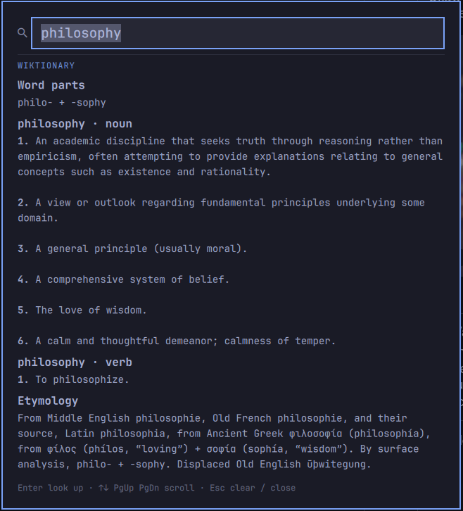

# Word Tap

Tap any word on screen with three fingers and get a macOS-style lookup popup:
definitions, the word's parts (`un- + believable`), its etymology, and a Wikipedia
summary for names, places and companies. Themed to your Omarchy theme.



- **Three-finger tap, anywhere.** Works in any app: the word under the pointer is read off the
  screen (OCR), so nothing is clicked or selected in the app underneath. Tap-to-click can stay off;
  swipes and three-finger clicks are ignored.
- **Other languages.** Words without an English entry show their meaning in another language,
  named: `schön` is *German adj: beautiful, lovely*, `hôtel de ville` *French noun: town hall*.
- **Accents.** The English OCR that ships with Omarchy drops or garbles accents (`schön` becomes
  `schon`, `grün` becomes `griin`). Two fixes, both automatic once in place:
  - When a word finds nothing, Wiktionary's search restores accents that were simply lost
    (`Letzebuergesch` → `Lëtzebuergesch`). It accepts a spelling that differs only by accents.
  - For accurate reading of accented text in any Latin-alphabet language (é ô ö ë ñ ø ß ...), run
    `scripts/ocr-accents enable` once. It downloads Tesseract's Latin-script model (89 MB, pinned and
    checksummed) and taps then take the accents from it. `ocr-accents disable` deletes it.
- **Phrases too.** Highlight a few words (up to 8), then tap on them to look up the whole phrase:
  `New York City`, `carpe diem`. A highlight somewhere else is ignored; the tap still looks up its
  own word.
- **Word parts and etymology** from [Wiktionary](https://en.wiktionary.org) (via
  [Kaikki.org](https://kaikki.org)'s machine-readable extracts). Inflections follow through:
  `berries` also shows `berry` and where it came from. Capitalised words try the proper noun first
  (`Paris` the city before `paris` the plant).
- **Wikipedia summaries** for what dictionaries miss: companies, cities, people.
- **Webster's 1913**, bundled and fully offline, as a fallback with "did you mean" suggestions.
- Type into the search box to look up anything else. Keyboard: `Enter` look up, `↑↓ PgUp PgDn`
  scroll, `Esc` clear / close.

Requires Omarchy 4.0.4 or newer (`OMARCHY_MIN_VERSION`).

## Requirements

All ship with Omarchy; nothing to install on a stock system.

| Needed for | Packages |
|---|---|
| Popup and dictionary engine | `jq`, `sqlite`, `xz`, `curl` |
| Reading the word under the pointer | `grim`, `imagemagick`, `tesseract`, `tesseract-data-eng`, `wl-clipboard` (optional: the Latin-script model, see Accents) |
| Tap detection | `python3` (standard library only) and read access to your touchpad (below) |

### Touchpad access (once)

Tap-to-click off means the compositor never reports a three-finger tap, so Word Tap reads the
touchpad itself. Grant your login session read access to **touchpads only** (keyboards and other
input devices are untouched):

```sh
~/.config/omarchy/plugins/stewartjarod.wordtap/scripts/touchpad-access enable
```

It writes one udev rule (`/etc/udev/rules.d/70-wordtap-touchpad-uaccess.rules`) that tags devices
udev classifies as touchpads with `uaccess`, and asks for your password through polkit.
`touchpad-access status` shows what is readable; `touchpad-access disable` removes the rule.
Without it, everything else works and the popup tells you taps are not available yet.

## Install

```sh
omarchy plugin add https://github.com/stewartjarod/omarchy-wordtap.git --enable
~/.config/omarchy/plugins/stewartjarod.wordtap/scripts/touchpad-access enable
```

Optional hotkeys in `~/.config/hypr/bindings.lua`:

```lua
local wordtap = os.getenv("HOME") .. "/.config/omarchy/plugins/stewartjarod.wordtap/scripts/"
o.bind("SUPER + ALT + D", "Look up word under pointer", wordtap .. "lookup-at-cursor")
o.bind("SUPER + ALT + SHIFT + D", "Look up selected text", wordtap .. "lookup-selection")
```

## Remove

```sh
~/.config/omarchy/plugins/stewartjarod.wordtap/scripts/touchpad-access disable
omarchy plugin remove stewartjarod.wordtap
rm -rf ~/.config/wordtap ~/.cache/wordtap ~/.local/share/wordtap
```

## Settings

Put only what you change in `~/.config/wordtap/config.json`; it is re-read automatically. Defaults
live in the plugin's `defaults.json`.

```json
{
  "sources": ["wiktionary", "wikipedia", "webster1913"],
  "tap": { "fingers": 3, "maxMs": 250, "maxMoveMm": 2.5 }
}
```

| Setting | Default | What it does |
|---|---|---|
| `sources` | `["wiktionary", "wikipedia", "webster1913"]` | Sources shown, top to bottom. Remove one to hide it; leave only `webster1913` to stay fully offline. |
| `ocrLanguages` | `["eng"]` | Tesseract languages that read the word under the pointer (at most four, run in parallel; the most confident reading wins). `"auto"` uses every installed pack. For accented Latin letters use `scripts/ocr-accents` instead; extra packs are for other scripts, e.g. `["eng", "rus"]`. |
| `tap.enabled` | `true` | Turn the tap gesture off (hotkeys keep working). |
| `tap.fingers` | `3` | Fingers in the tap. |
| `tap.maxMs` | `250` | Longest touch, first finger down to lift, that still counts as a tap. |
| `tap.maxMoveMm` | `2.5` | How far any finger may travel. Larger is more forgiving, but swipes may trigger it. |
| `tap.cooldownMs` | `400` | Minimum gap between two lookups. |
| `tap.devices` | `[]` | Name substrings to watch (e.g. `["Magic Trackpad"]`); empty watches every touchpad. |
| `tap.debug` | `false` | Log every touch (fingers, duration, travel) to the shell's log, for tuning: `journalctl --user -f \| grep wordtap`. |

## Where things are stored

| What | Where | Notes |
|---|---|---|
| Your settings | `~/.config/wordtap/config.json` | Optional. |
| Lookup cache | `~/.cache/wordtap/` | Online responses (30 days Wiktionary, 7 days Wikipedia; a "not found" for a day, a timeout not at all) and the unpacked Webster's database. Mode 0700. Safe to delete. |
| Accents model | `~/.local/share/wordtap/tessdata/` | Only after `scripts/ocr-accents enable` (89 MB). `ocr-accents disable` removes it. |

## Privacy

- The word you tap or type is sent to `kaikki.org` and `en.wikipedia.org` over HTTPS to fetch its
  entry, unless you remove those sources. When nothing is found, it also goes to `en.wiktionary.org`'s
  search to restore lost accents. Nothing else leaves the machine: no account, no API key,
  no analytics.
- The text you look up never appears on a command line, where other users on the machine could read it:
  it reaches the popup through a private file under `$XDG_RUNTIME_DIR/wordtap/` (deleted once read) and the
  lookup helpers through their environment or input.
- Reading the word under the pointer takes a 500×70 px screenshot around it, runs OCR locally, and
  deletes the image immediately.
- Each tap also reads your highlighted text (the primary selection, not the clipboard) to check
  whether you tapped on it. It stays on the machine and is only looked up when it matches the words
  under the pointer.
- The tap watcher reads touch positions from touchpads only; it never reads keyboards and keeps no
  record of touches (debug mode logs counts and distances, not positions).

## Credits

- The popup and dictionary engine started as [Look Up](https://github.com/keegan-sucks/omarchy-lookup)
  by keegan-sucks (MIT).
- Webster's Revised Unabridged Dictionary (1913), public domain, via GCIDE
  (`tools/build-webster-db.sh` rebuilds the database).
- Wiktionary and Wikipedia content is CC BY-SA 4.0; Wiktionary data via Kaikki.org (Tatu Ylonen,
  wiktextract).

## Development

```sh
tests/run-all.sh        # lint, theme + token checks, unit tests (no desktop needed)
tests/smoke.sh          # live check against the running shell
scripts/release.sh      # cut a release from Conventional Commits
```

`scripts/lookup-at-cursor X Y` looks at a fixed screen point instead of the pointer, for testing.
See [CONTRIBUTING.md](CONTRIBUTING.md) and [AGENTS.md](AGENTS.md).
